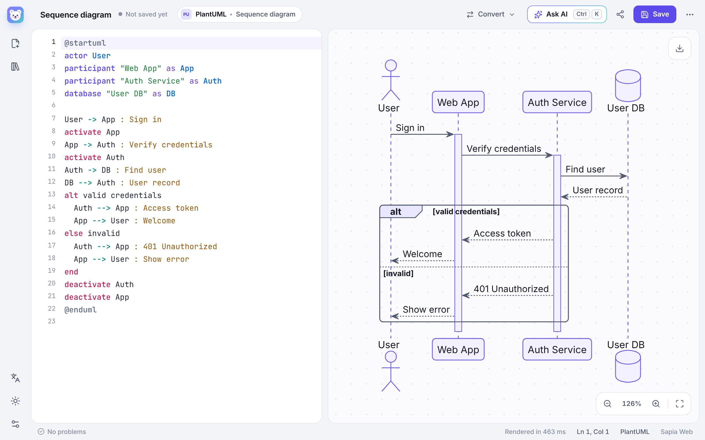
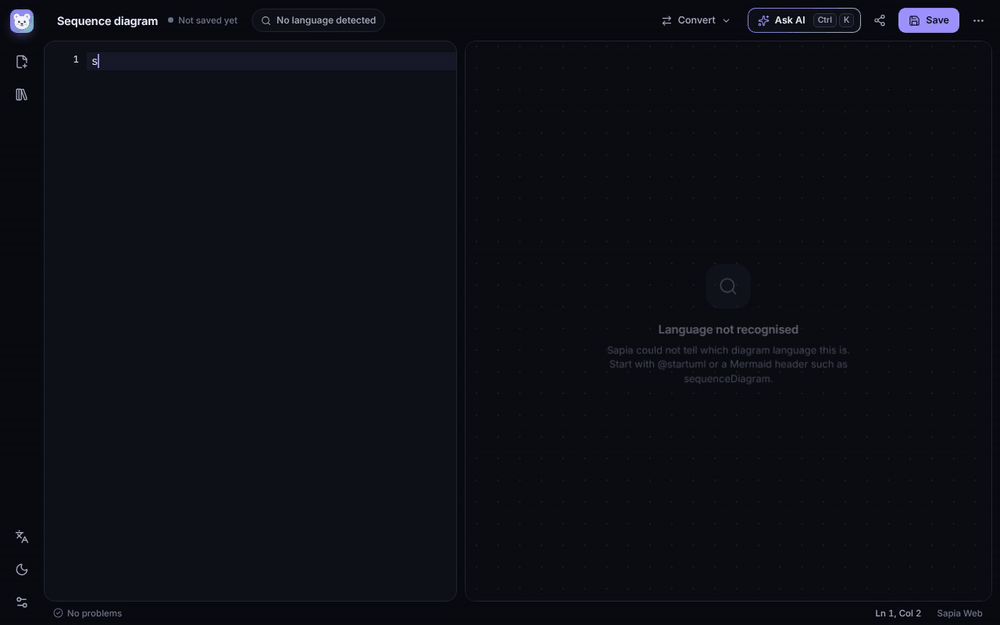
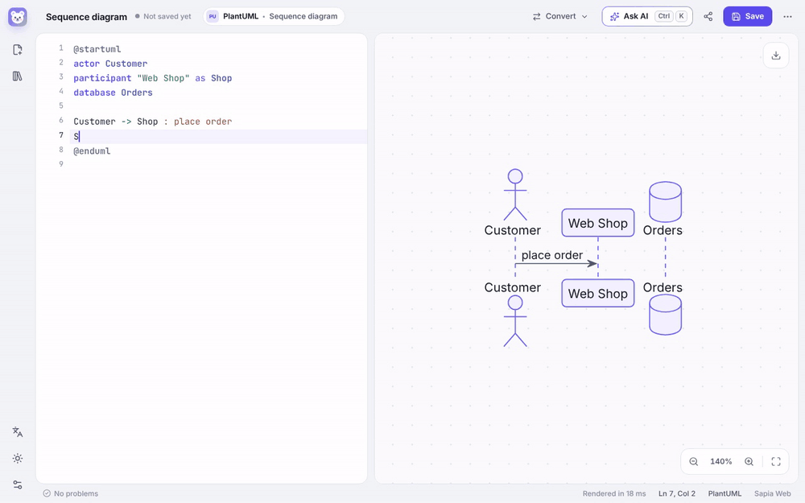
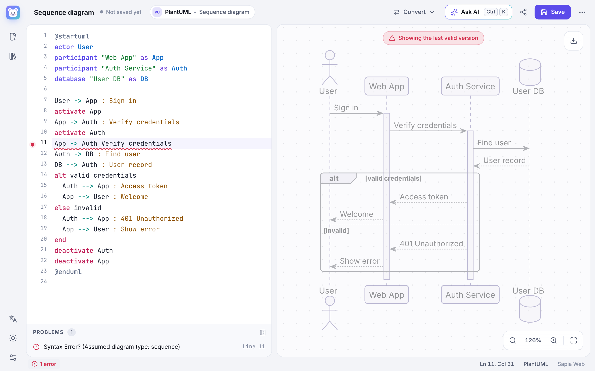
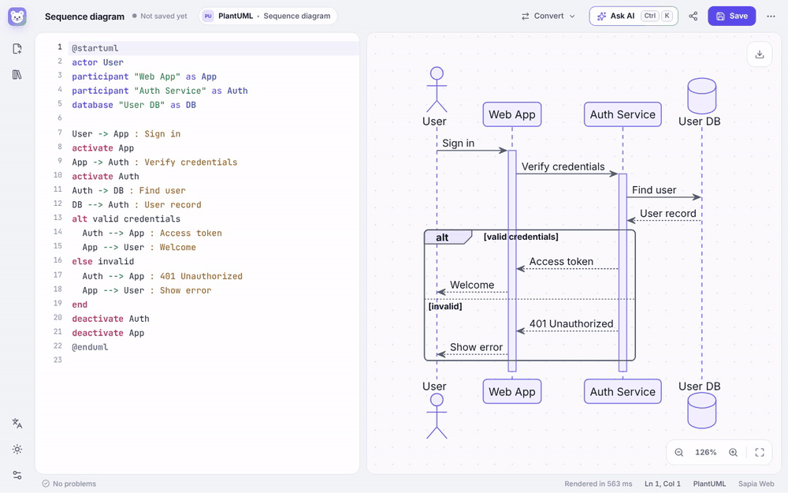
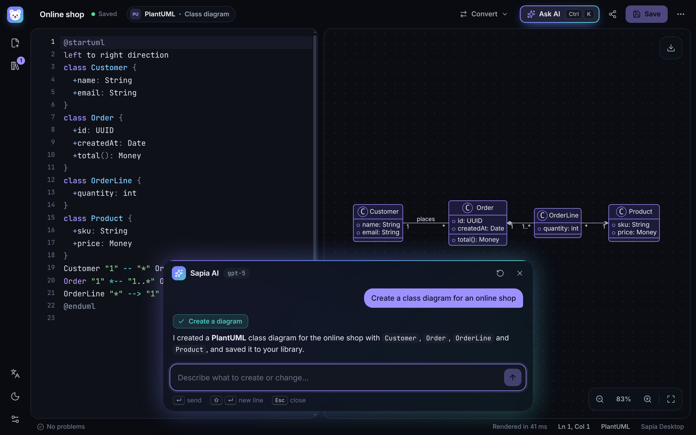
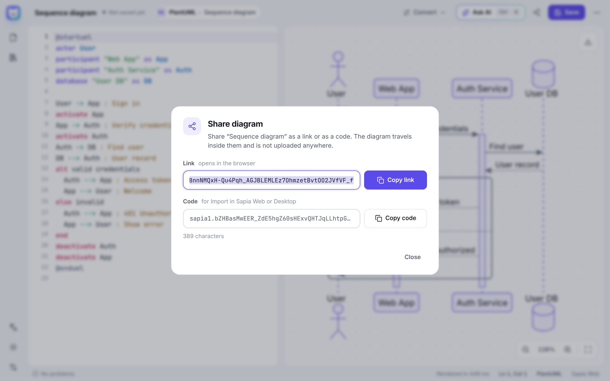
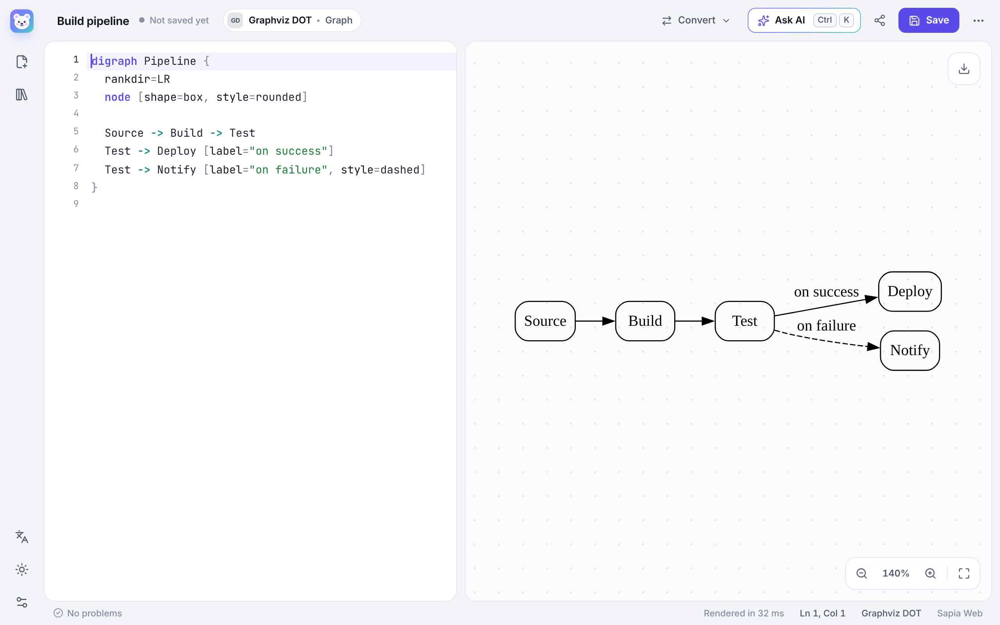

<p align="center">
  
</p>

<h1 align="center">Sapia</h1>

<p align="center">
  A modern editor for text-based diagrams.<br>
  Write PlantUML or Mermaid on the left, watch the diagram appear on the right.
</p>

<p align="center">
  <a href="https://www.npmjs.com/package/@sapia/desktop"></a>
  <a href="https://www.npmjs.com/package/@sapia/web"></a>
  <a href="LICENSE"></a>
</p>



```bash
npm install -g @sapia/desktop
sapia
```

That is all it takes for the desktop app. Prefer the browser? [`@sapia/web`](packages/sapia-web) is the same editor as a static site.

## What Sapia does

### Live rendering

The diagram is redrawn while you type, with pan, zoom, click-to-source and SVG/PNG export. PlantUML runs locally in the app, without a server or Java.



### Diagram detection and context-aware completion

Sapia recognises the language and the diagram type on its own (PlantUML or Mermaid, sequence, class, state, mind map, …), so there is nothing to pick. Completion knows where you are: keywords at the start of a line, the participants you already declared after an arrow, snippets for blocks like `alt` or `loop`.



### Errors where they happen

Syntax errors are underlined in the editor and listed under *Problems*. The preview keeps showing the last valid version, so the diagram doesn't vanish while you are in the middle of a line.



### PlantUML and Mermaid built in, with conversion

Both languages ship with Sapia, as plugins. **Convert** turns a diagram into the other language: a sequence, class, state or mind map diagram is parsed into a language-neutral model of its type and written out again. One click, and undo if you change your mind.



### AI assistant (desktop)

Press `Ctrl/Cmd+K` and describe what you want. The assistant creates, edits, checks and converts diagrams through the same tools you use, and you see every step. It works with OpenAI and any OpenAI-compatible server (Ollama, LM Studio, vLLM, …); the API key stays in the desktop app's main process.



### Share as a link

**Share** packs the whole diagram, compressed, into a link or a short code. Nothing is uploaded: whoever opens the link gets the diagram straight from the URL.



### Plugins for more languages

Everything a language needs (detection, highlighting, completion, diagnostics, rendering, click-to-source, conversion) comes from plugins, and PlantUML and Mermaid are plugins too. A plugin is one ES module; [`examples/sapia-plugin-dot`](examples/sapia-plugin-dot) adds Graphviz DOT in a single dependency-free file. See [Writing a plugin](#writing-a-plugin).



Also included: a library for your diagrams, light and dark mode (diagram colours adapt too, with readable contrast), and an English and German UI.

## Packages

| Package | Purpose |
| --- | --- |
| [`packages/sapia-core`](packages/sapia-core) (`@sapia/core`) | Everything that is not UI: plugin system, language registry and detection, tokenizer toolkit, metamodels, conversion, i18n, config, storage and the AI tool contracts. |
| [`packages/sapia-plugin-plantuml`](packages/sapia-plugin-plantuml) (`@sapia/plugin-plantuml`) | PlantUML support, built on `@plantuml/core`. |
| [`packages/sapia-plugin-mermaid`](packages/sapia-plugin-mermaid) (`@sapia/plugin-mermaid`) | Mermaid support. |
| [`packages/sapia-web`](packages/sapia-web) (`@sapia/web`) | The web application: Angular (zoneless) with Angular Material and CodeMirror 6. Published as a ready-built static site. |
| [`packages/sapia-desktop`](packages/sapia-desktop) (`@sapia/desktop`) | The desktop application: Electron shell around `sapia-web`, plus config file, npm/local plugins and the AI backend. |
| [`examples/sapia-plugin-dot`](examples/sapia-plugin-dot) | A dependency-free example plugin (Graphviz DOT). |

## Building from source

Requires Node.js 22 or newer.

```bash
npm install
npm start            # web app on http://localhost:4200
npm run start:desktop  # builds everything and opens the desktop app
npm test             # unit tests
npm run build        # libraries, web app and desktop bundle
```

## Sharing diagrams

**Share** (top bar) packs the whole diagram, compressed, into a link and into a code. Nothing is stored or sent anywhere: the diagram lives only in the link or code itself.

- **Web app:** the link points to the app's own address with the diagram in the URL fragment, `https://…/#d=…`. Browsers never send the fragment to the server. Opening the link loads the diagram as a new, unsaved document and removes it from the address bar.
- **Desktop app:** the link is `sapia://open/#d=…`. The app registers the `sapia:` scheme with the operating system, so clicking such a link opens the diagram in Sapia.
- **Code:** both apps also offer a share code, `sapia1.…`, which carries the same content without any address. It works between web and desktop and survives tools that mangle links.
- **Import** (⋯ menu) accepts a code or any share link, https or `sapia://`.
- Very long links (over 8000 characters) can get cut off by chat tools or mail clients. The share dialog warns about that; the code is the safer choice then.

## Sapia Desktop

```bash
npm install -g @sapia/desktop
sapia
```

On first start, Sapia asks for language and theme, optionally connects an AI provider (with a connection test) and writes `~/.sapia/config.json`. Diagrams are stored as files in `~/.sapia/diagrams`. Set `SAPIA_HOME` to use another directory.

On the very first start, `sapia` downloads the Electron runtime (about 110 MB) into `~/.sapia/electron`; later starts use it directly. No install scripts are involved, so this also works with `--ignore-scripts` and with a global installation owned by root.

Behind a company proxy:

- The proxy comes from `HTTPS_PROXY` / `NO_PROXY`, or else from npm's own configuration (`npm config get https-proxy`).
- If the proxy inspects TLS, Sapia retries with the operating system's certificates and npm's `cafile`. Otherwise point it to the company root certificate with `NODE_EXTRA_CA_CERTS=/path/to/ca.pem`.
- `ELECTRON_MIRROR=https://mirror.example.com/electron/` downloads from an internal mirror (Artifactory, Nexus, …) instead of GitHub.
- `SAPIA_ELECTRON_PATH=/path/to/electron` uses an Electron binary you already have.

If the download fails, `sapia` says why and which of these settings helps.

### Configuration (`~/.sapia/config.json`)

```jsonc
{
  "version": 1,
  "locale": "auto",            // "auto", "en" or "de"; unknown locales fall back to English
  "theme": "system",           // "system", "light" or "dark"
  "diagramTheme": "adaptive",  // "adaptive": diagram colours follow light/dark mode; "static": always the light look
  "editor": { "fontSize": 14, "tabSize": 2, "lineNumbers": true, "wordWrap": false, "renderDelay": 250 },

  "plugins": [
    "sapia-plugin-d2",                         // npm package
    "~/dev/my-plugin",                         // local folder or file
    { "package": "@acme/sapia-c4", "options": { "strict": true } },
    { "path": "./plugins/experimental", "enabled": false }
  ],
  "disabledPlugins": [],                       // plugin ids, e.g. "sapia.mermaid"
  "pluginOptions": { "sapia.plantuml": { "look": "sapia" } },

  "ai": {
    "enabled": true,
    "provider": "openai",
    "maxSteps": 12,
    "providers": {
      "openai": { "type": "openai-responses", "model": "gpt-5", "apiKeyEnv": "OPENAI_API_KEY" },
      "local":  { "type": "openai-chat", "model": "qwen3", "baseUrl": "http://localhost:11434/v1" }
    }
  },

  "storage": { "directory": "~/Documents/diagrams" },
  "keybindings": { "aiAssistant": "Mod-k", "save": "Mod-s", "newDiagram": "Mod-Alt-n", "openLibrary": "Mod-o", "convert": "Mod-Shift-e" }
}
```

Every key is optional. Problems in the file are listed under *Plugins & settings → Configuration*; Sapia never overwrites a file it cannot parse.

### Plugins from npm or a local path

```bash
npm install --prefix ~/.sapia/plugins sapia-plugin-d2
```

Then add the package name to `plugins`. Packages are looked up in `~/.sapia/plugins/node_modules`, next to a globally installed `@sapia/desktop`, in `NODE_PATH` and in the global npm root. A path may point to a package folder or to a single module file.

### AI providers

Two provider types are built in, both running through the [Vercel AI SDK](https://ai-sdk.dev) in the main process:

| `type` | API |
| --- | --- |
| `openai-responses` | OpenAI Responses API |
| `openai-chat` | OpenAI Chat Completions, also spoken by most compatible servers (set `baseUrl`) |

The key comes from `apiKey`, from the environment variable named in `apiKeyEnv`, or from `OPENAI_API_KEY`. It stays in the main process: the UI only receives a redacted config, and the model's tool calls are executed in the UI against the open workspace.

Plugins can add provider types, see below.

## Sapia Web

`npm run build:web` produces a static site in `packages/sapia-web/dist/sapia-web/browser`; the same build is published as [`@sapia/web`](https://www.npmjs.com/package/@sapia/web). It optionally loads `config.json` from its own deployment URL (see [`config.example.json`](packages/sapia-web/public/config.example.json)); plugins are referenced there by URL. For a deployment below a sub-path, build with `--base-href /your/path/`. Diagrams are kept in the browser's local storage. The AI assistant is part of the desktop app, because a browser cannot keep an API key secret.

## Writing a plugin

A plugin is an ES module whose default export has an `id` and an `activate(context)` function. Everything registered through the context is removed again when the plugin is deactivated.

```ts
import { definePlugin } from '@sapia/core';

export default definePlugin({
  id: 'acme.d2',
  name: 'D2',
  activate(context) {
    context.languages.register({
      id: 'd2',
      name: 'D2',
      diagramTypes: [{ id: 'graph', template: 'a -> b\n' }],
      detect: (source) => (/^\s*\w+\s*->\s*\w+/m.test(source) ? { confidence: 0.5, diagramType: 'graph' } : null),
      tokenizer,        // highlighting
      complete,         // completion, with access to source and cursor
      validate,         // diagnostics
      render,           // returns an SVG
      locate,           // maps a clicked SVG element to a source range
    });
    context.conversion.registerMapper(sequenceMapper); // language <-> metamodel of one diagram type
    context.ai.registerTool(myTool);                   // extra tool for the assistant
    context.i18n.addMessages('de', { 'diagramType.graph': 'Graph' });
  },
});
```

Conversion always goes through a metamodel: a mapper parses its language into the model of one diagram type and generates the language from it. Two languages can be converted into each other as soon as both have a mapper for the same diagram type.

The module is loaded by the UI as it is, so bundle its dependencies. In `package.json`, point `sapia.plugin` at the module:

```json
{ "name": "sapia-plugin-d2", "sapia": { "plugin": "./dist/index.js", "main": "./dist/main.cjs" } }
```

`sapia.main` is optional and names a module for the desktop main process. Its `activate` can register AI provider types:

```js
exports.activate = (context) => {
  context.registerAiProvider({
    info: { id: 'anthropic', name: 'Anthropic', defaultModel: '…', apiKeyEnv: 'ANTHROPIC_API_KEY' },
    createModel: ({ config, apiKey }) => createAnthropic({ apiKey })(config.model), // any AI SDK language model
  });
};
```

[`examples/sapia-plugin-dot`](examples/sapia-plugin-dot) is a complete plugin in one file.

## Architecture

```
sapia-core            languages · detection · metamodels · conversion · i18n · config · AI tools · plugin manager
   ▲        ▲
   │        └── sapia-plugin-plantuml, sapia-plugin-mermaid, your plugins
sapia-web             Angular shell, CodeMirror editor, preview, library, AI widget, onboarding UI
   ▲
sapia-desktop         Electron: serves sapia-web, ~/.sapia/config.json, plugin resolution, diagram files, AI backend
```

The desktop app adds a small delta to the web app: the page runs sandboxed with context isolation and talks to the main process through one narrow bridge (`window.sapiaHost`, typed as `SapiaHost` in `@sapia/core`). Without that bridge, the same build behaves as the web app.

## Releasing

All packages (`@sapia/core`, `@sapia/plugin-plantuml`, `@sapia/plugin-mermaid`, `@sapia/web`, `@sapia/desktop`) share one version. `main` carries the next version as a snapshot (`X.Y.Z-snapshot.0`), which is never published.

To release, push a tag on the commit you want to ship:

```bash
git tag v0.1.1
git push origin v0.1.1
```

The [release workflow](.github/workflows/release.yml) sets the version from the tag on all packages (only inside the run), builds, tests and publishes them to npm with provenance, then commits the next snapshot (`0.1.2-snapshot.0`) to `main`. Versions already on npm are skipped, so a failed run can be re-run. `node scripts/set-version.mjs <version>` does the same version change locally.

npm authentication, one of:

- **Trusted publishing (recommended, no secret):** on npmjs.com, open each of the five packages → *Settings* → *Trusted Publisher* → *GitHub Actions*, with organization/user `Hakenadu`, repository `sapia`, workflow filename `release.yml`, no environment. The package has to exist on npm once before this is possible.
- **Token:** create a granular access token on npmjs.com with read and write access to the `@sapia` scope (and "bypass 2FA" if the account requires 2FA for writes), and store it as the repository secret `NPM_TOKEN`.

If `main` is protected against direct pushes, allow GitHub Actions to push to it, or the snapshot step fails after a successful publish.
