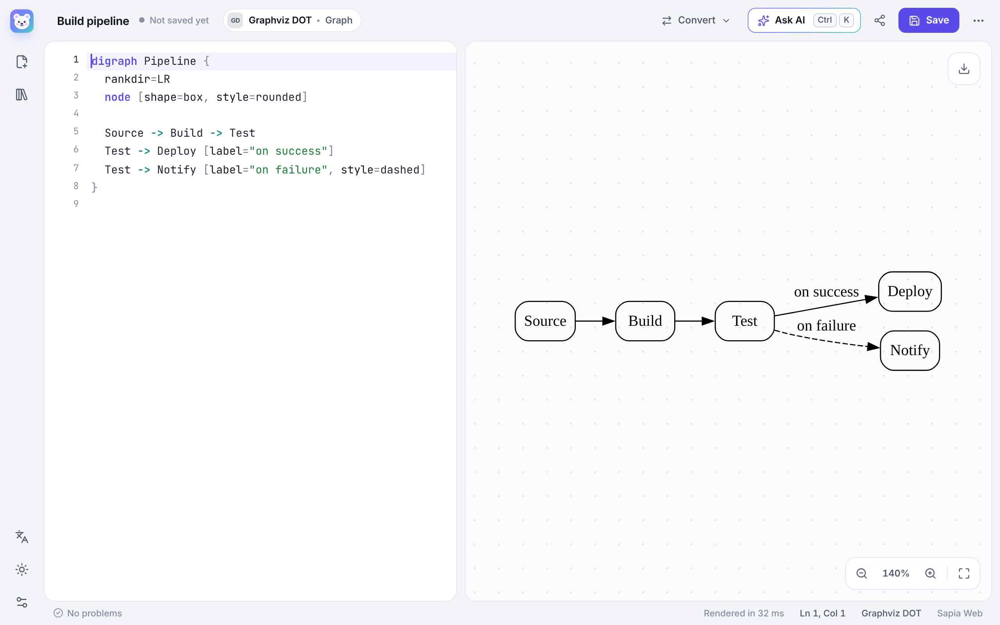

# sapia-plugin-dot

A small, dependency-free example plugin that adds **Graphviz DOT** to Sapia:
detection, highlighting, context-aware completion, rendering and click-to-source.



Everything lives in [`index.js`](index.js), one ES module without dependencies or build step.

Try it with Sapia Desktop by referencing the folder in `~/.sapia/config.json`:

```json
{
  "plugins": ["/path/to/sapia/examples/sapia-plugin-dot"]
}
```

For the web app, serve `index.js` somewhere and reference its URL in the deployment's `config.json`.
