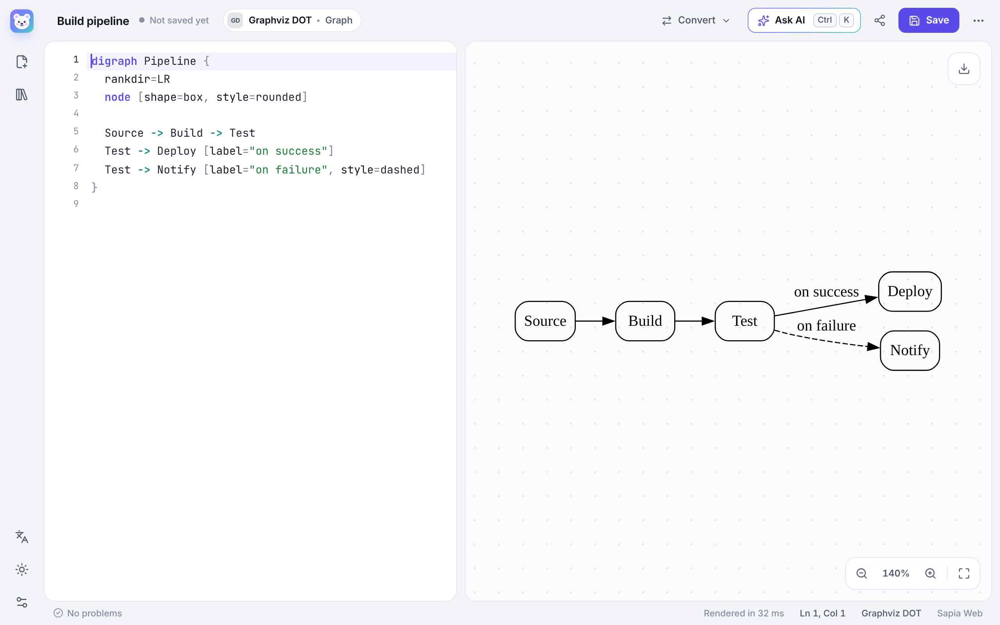

# @sapia/core

The heart of [Sapia](https://github.com/Hakenadu/sapia), an editor for text-based diagrams, without any UI: the plugin system, language registry and detection, diagram metamodels, conversion, i18n, storage, config and the AI tool contracts.

```bash
npm install @sapia/core
```

Use it to **write a Sapia plugin** or to put Sapia's diagram tooling into your own tool. The modules are ES modules for bundlers (esbuild, Vite, webpack, …).

## Plugins add languages

Sapia itself knows no diagram language. Everything comes from plugins, PlantUML and Mermaid included. A plugin is one ES module that registers what a language needs:

```ts
import { definePlugin } from '@sapia/core';

export default definePlugin({
  id: 'acme.d2',
  name: 'D2',
  activate(context) {
    context.languages.register({
      id: 'd2',
      name: 'D2',
      diagramTypes: [{ id: 'graph', template: 'a -> b\n' }],
      detect: (source) => (/^\s*\w+\s*->\s*\w+/m.test(source) ? { confidence: 0.5, diagramType: 'graph' } : null),
      tokenizer, // highlighting
      complete,  // completion, with access to source and cursor
      validate,  // diagnostics shown in the editor
      render,    // returns an SVG
      locate,    // maps a clicked SVG element back to the source
    });
    context.conversion.registerMapper(mapper); // language <-> metamodel of one diagram type
    context.ai.registerTool(tool);             // extra tool for the AI assistant
  },
});
```

The [Graphviz DOT example](https://github.com/Hakenadu/sapia/tree/main/examples/sapia-plugin-dot) is a complete plugin in one dependency-free file, with detection, highlighting, completion, rendering and click-to-source:



Load it in [Sapia Desktop](https://www.npmjs.com/package/@sapia/desktop) by adding its folder or npm package name to `"plugins"` in `~/.sapia/config.json`, or in [Sapia Web](https://www.npmjs.com/package/@sapia/web) by URL in the deployment's `config.json`.

## Conversion through metamodels

Languages are never translated directly into each other. A mapper parses its language into the model of one diagram type (sequence, class, state, mind map) and generates the language from it. As soon as two languages have a mapper for the same diagram type, they can be converted into each other.

```ts
import { createSapia } from '@sapia/core';
import plantUml from '@sapia/plugin-plantuml';
import mermaid from '@sapia/plugin-mermaid';

const sapia = createSapia();
await sapia.plugins.activate(plantUml);
await sapia.plugins.activate(mermaid);

const source = '@startuml\nAlice -> Bob : hello\n@enduml';
const { languageId, diagramType } = sapia.languages.detect(source)!; // 'plantuml', 'sequence'
const result = sapia.conversion.convert({ source, from: languageId, to: 'mermaid', diagramType });
console.log(result.source); // sequenceDiagram …
```

More in [Writing a plugin](https://github.com/Hakenadu/sapia#writing-a-plugin) · MIT license
