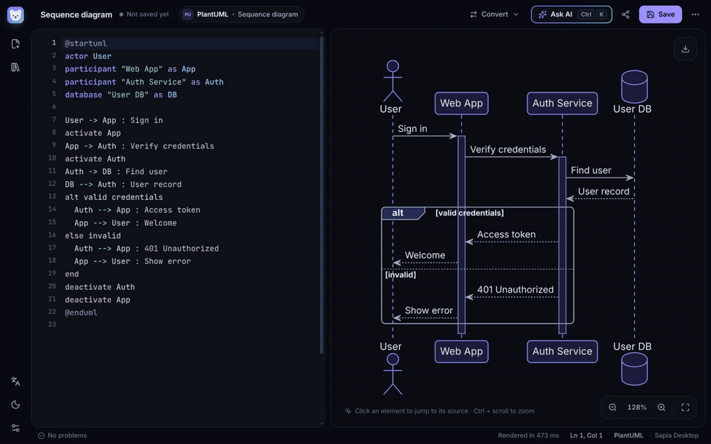
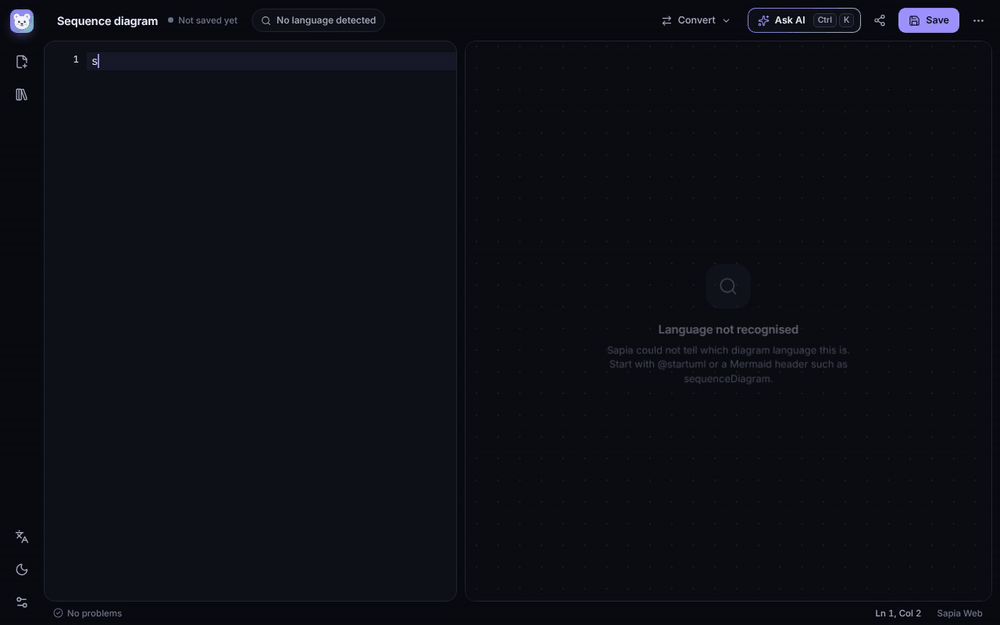
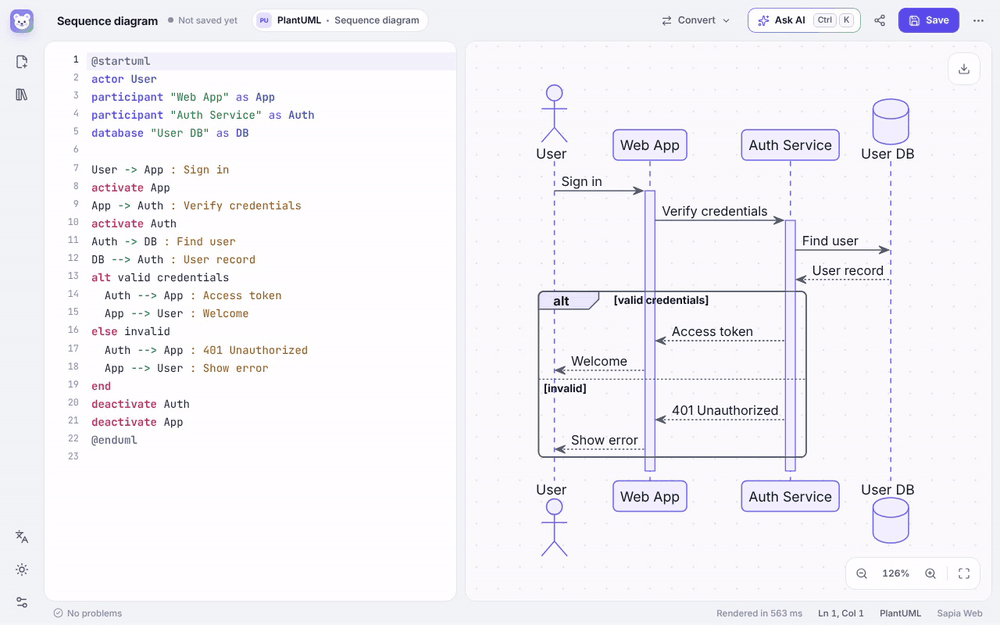
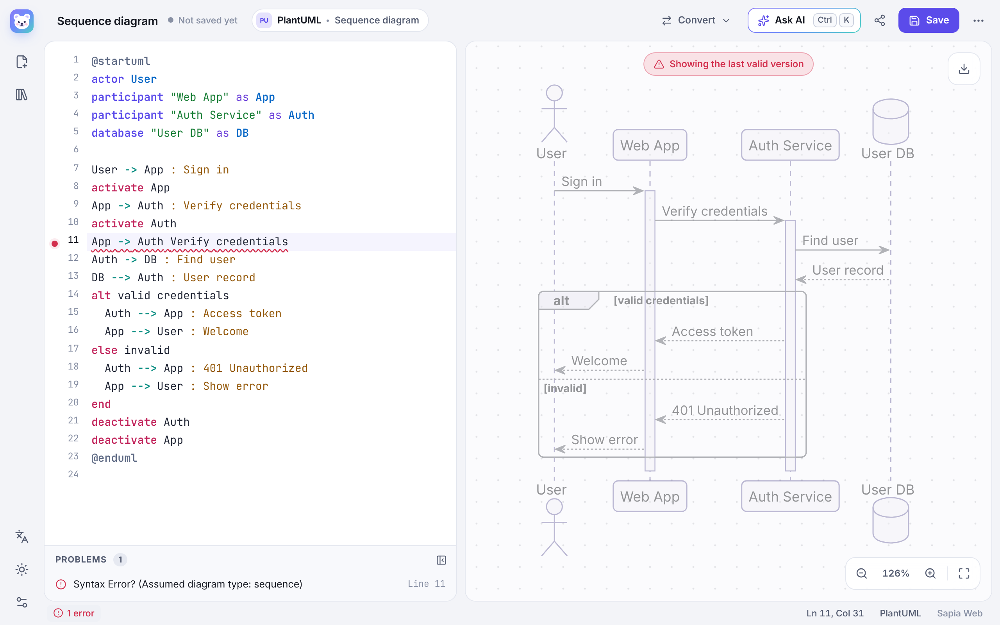
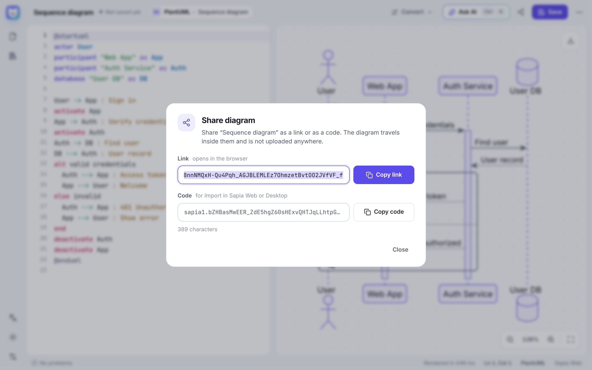

# Sapia Desktop

A modern editor for text-based diagrams. Write PlantUML or Mermaid, see the diagram as you type, and ask the built-in AI assistant when you'd rather describe than write.



```bash
npm install -g @sapia/desktop
sapia
```

Requires Node.js 22 or newer. On first start Sapia asks for language and theme, optionally connects an AI provider and downloads the Electron runtime once (about 110 MB, into `~/.sapia/electron`). `sapia --wait` keeps the terminal attached and shows the log.

## What you get

- **Live rendering.** The preview is redrawn while you type, with pan, zoom, click-to-source and SVG/PNG export. PlantUML runs locally, no server or Java needed.
- **Detection and completion.** Sapia recognises language and diagram type by itself and completes keywords, snippets and the names already used in your diagram, only where the syntax allows them.
- **Errors where they happen.** Problems are underlined in the editor and listed under *Problems*; the preview keeps the last valid version.
- **PlantUML and Mermaid built in**, and **Convert** turns sequence, class, state and mind map diagrams from one into the other.
- **Projects** in folders or Git repositories: every save in a Git project is committed and pushed, and conflicts are resolved diagram by diagram.
- **AI assistant** on `Ctrl/Cmd+K`: it drafts, edits, checks and converts diagrams with the same tools you use, and only you save. OpenAI and any OpenAI-compatible server (Ollama, LM Studio, vLLM, …) work out of the box; the API key never leaves the main process.
- **Share links.** A diagram travels inside a `sapia://` link or a short code. Nothing is uploaded anywhere.
- **Plugins** for more languages, from npm or a local folder. See the [Graphviz DOT example](https://github.com/Hakenadu/sapia/tree/main/examples/sapia-plugin-dot).

| Live rendering, detection and completion | Conversion PlantUML → Mermaid |
| --- | --- |
|  |  |
| **Errors in the editor** | **Share link and code** |
|  |  |

## Where things live

- Configuration: `~/.sapia/config.json` (set `SAPIA_HOME` to use another directory). Every key is optional.
- Diagrams: in projects. The default project uses `~/.sapia/diagrams`, one file each; folder projects keep plain `.puml`/`.mmd` files in a folder of your choice; Git projects commit and push every save (clones live in `~/.sapia/projects`). The list of projects is `~/.sapia/projects.json`.
- Plugins: `npm install --prefix ~/.sapia/plugins <package>`, then add the package name to `"plugins"` in the config. Local folders work too.
- AI: configured under `"ai"` in the config, or during the first start.

Behind a company proxy, Sapia uses `HTTPS_PROXY`/`NO_PROXY` or npm's proxy settings and the operating system's certificates; `ELECTRON_MIRROR` selects an internal mirror. Details: [Sapia Desktop](https://github.com/Hakenadu/sapia#sapia-desktop).

[Full documentation](https://github.com/Hakenadu/sapia#readme) · MIT license
