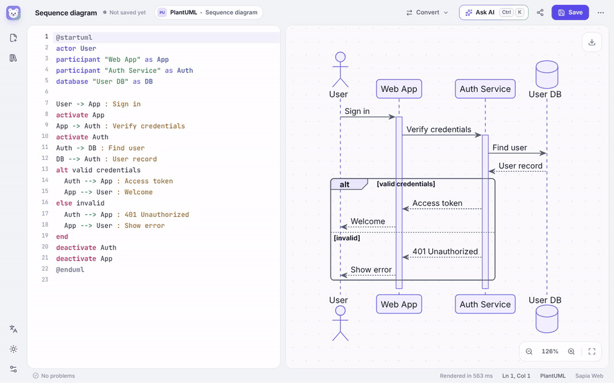

# @sapia/plugin-plantuml

PlantUML support for [Sapia](https://github.com/Hakenadu/sapia), the editor for text-based diagrams. It is built into [Sapia Desktop](https://www.npmjs.com/package/@sapia/desktop) and [Sapia Web](https://www.npmjs.com/package/@sapia/web) already; you only need this package to build your own Sapia distribution or to reuse the PlantUML tooling elsewhere.

```bash
npm install @sapia/plugin-plantuml @sapia/core
```

## What it adds

- **Detection** of PlantUML and of the diagram type (sequence, class, state, mind map, …).
- **Highlighting** and **context-aware completion**: keywords, snippets and the names already used in the diagram, offered only where the syntax allows them.
- **Diagnostics**: syntax errors marked in the editor.
- **Rendering** to SVG with click-to-source. Rendering uses [`@plantuml/core`](https://www.npmjs.com/package/@plantuml/core) and runs entirely in the browser or the desktop app: no PlantUML server, no Java. Sapia's own look is the default; set the plugin option `look` to `"plantuml"` for the classic one.
- **Conversion** to and from Mermaid for sequence, class, state and mind map diagrams, through Sapia's metamodels.



## Usage

It is a regular Sapia plugin (id `sapia.plantuml`), so it is activated like any other:

```ts
import { createSapia } from '@sapia/core';
import plantuml from '@sapia/plugin-plantuml';

const sapia = createSapia();
await sapia.plugins.activate(plantuml);
```

Together with [`@sapia/plugin-mermaid`](https://www.npmjs.com/package/@sapia/plugin-mermaid), `sapia.conversion.convert(…)` translates between the two; see [`@sapia/core`](https://www.npmjs.com/package/@sapia/core) for an example and for writing plugins of your own.

[Full documentation](https://github.com/Hakenadu/sapia#readme) · MIT license
