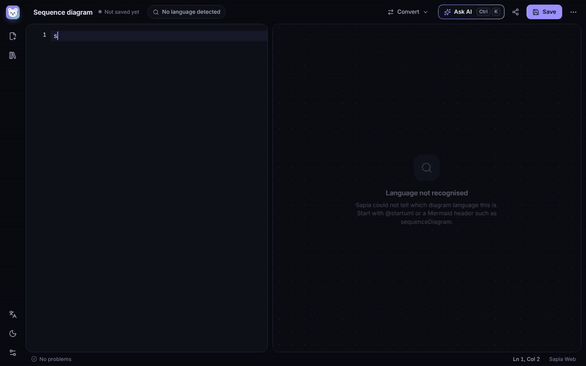
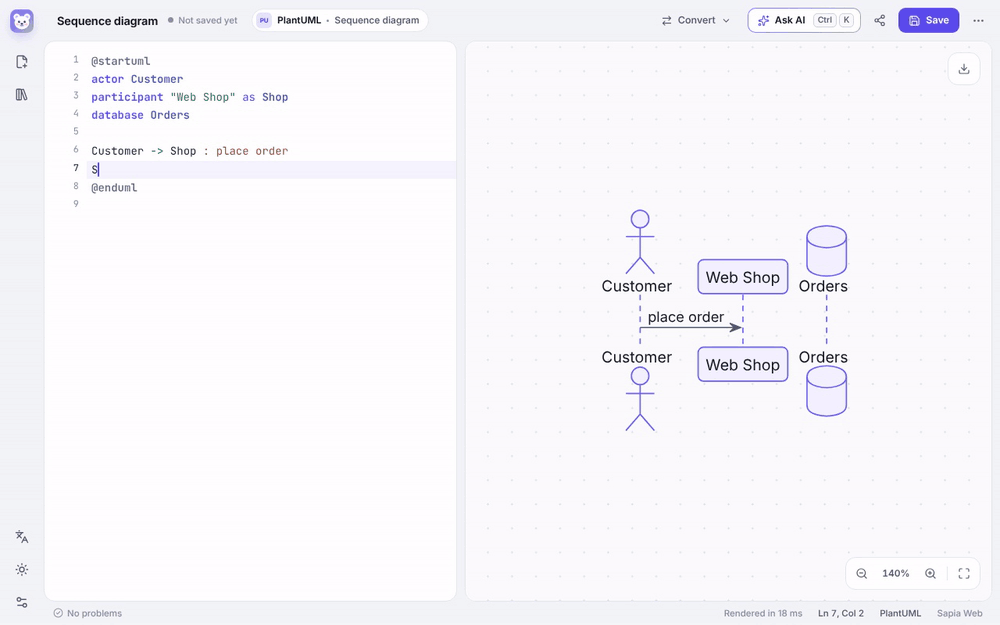
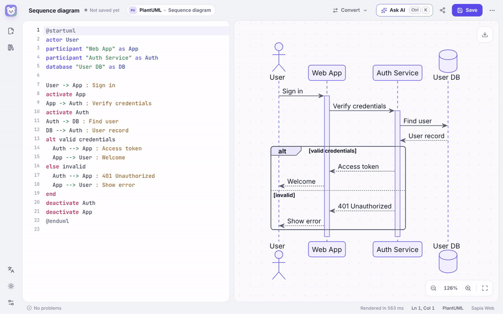
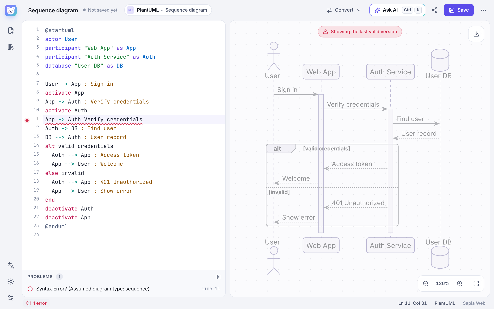
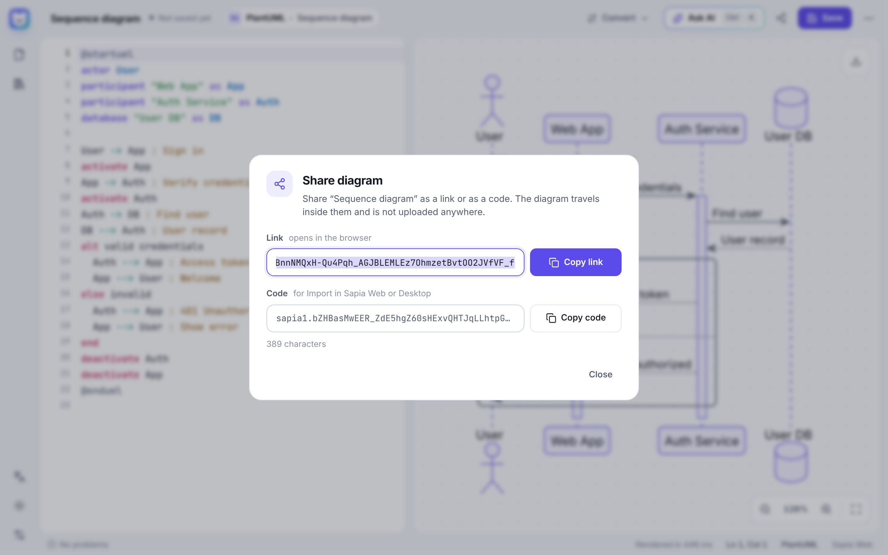

# Sapia Web

The Sapia diagram editor as a ready-built static site. Write PlantUML or Mermaid, see the diagram as you type. Drop the folder onto any web server and you're done.



```bash
npm install @sapia/web
npx http-server node_modules/@sapia/web/dist/sapia-web/browser
```

The site lies in `node_modules/@sapia/web/dist/sapia-web/browser`. Copy that folder to nginx, Apache, S3, GitHub Pages or wherever you like. The package has no runtime dependencies; everything is bundled.

## What you get

- **Live rendering** with pan, zoom, click-to-source and SVG/PNG export. PlantUML renders in the browser, no server or Java needed.
- **Detection and completion.** Language and diagram type are recognised automatically; completion offers keywords, snippets and the names already used in your diagram.
- **Errors where they happen.** Underlined in the editor, listed under *Problems*, while the preview keeps the last valid version.
- **PlantUML and Mermaid built in**, with **Convert** between them for sequence, class, state and mind map diagrams.
- **Share links.** The diagram travels compressed in the URL fragment (`#d=…`), which browsers never send to a server. No backend needed.
- **Plugins** for more languages, loaded by URL. See the [Graphviz DOT example](https://github.com/Hakenadu/sapia/tree/main/examples/sapia-plugin-dot).
- Light and dark mode, English and German.

| Context-aware completion | Conversion PlantUML → Mermaid |
| --- | --- |
|  |  |
| **Errors in the editor** | **Share link and code** |
|  |  |

The AI assistant is part of [`@sapia/desktop`](https://www.npmjs.com/package/@sapia/desktop), because a browser cannot keep an API key secret.

## Configuration

Sapia loads an optional `config.json` from its own deployment URL (see `config.example.json` in the same folder). Plugins are referenced there by URL, relative to the site or absolute (then the server needs CORS):

```json
{ "version": 1, "plugins": ["./sapia-plugin-dot.js"] }
```

The build expects to be served from the root path; for a sub-path, build from source with `--base-href /your/path/`. Diagrams are kept in the browser's local storage.

[Full documentation](https://github.com/Hakenadu/sapia#readme) · MIT license
